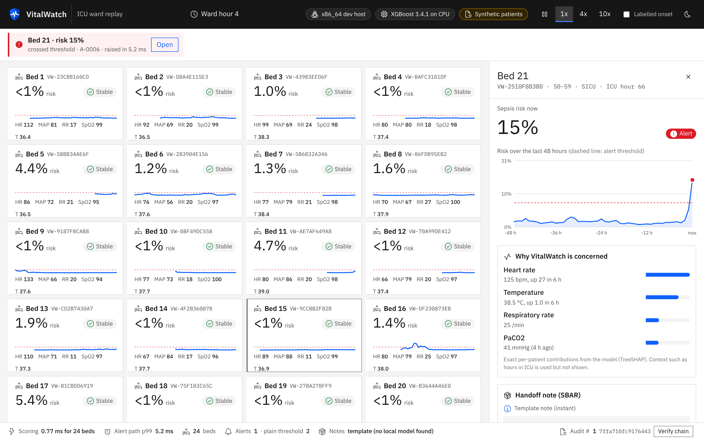
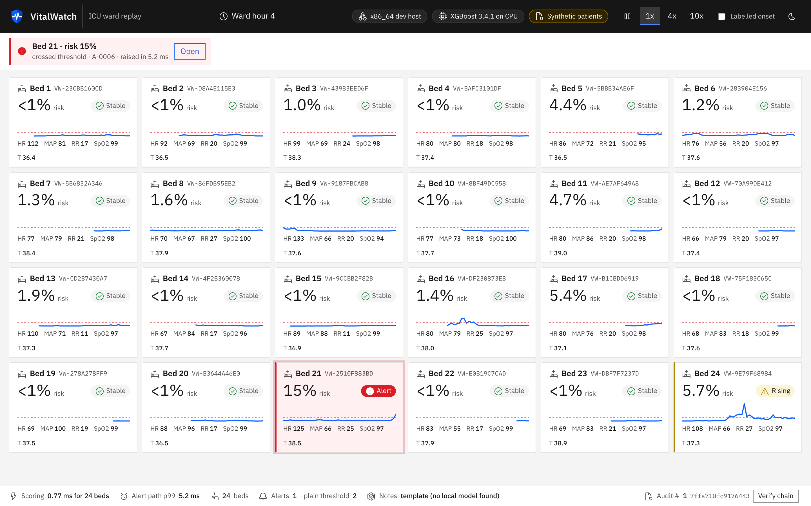
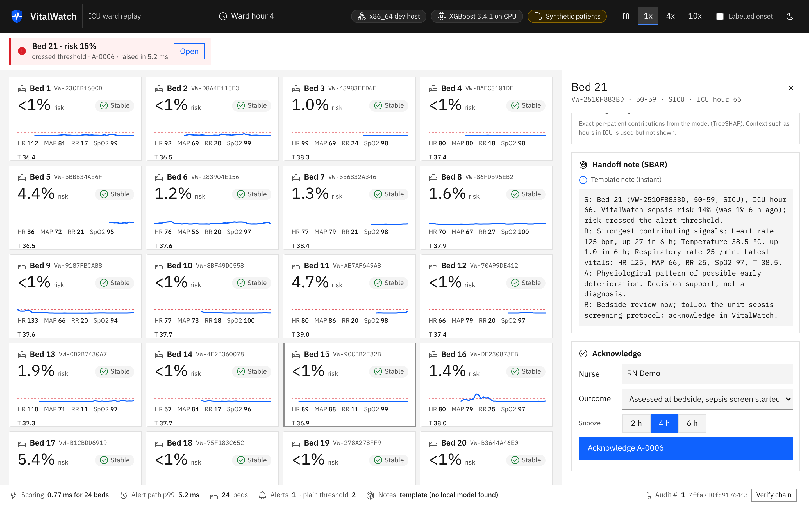
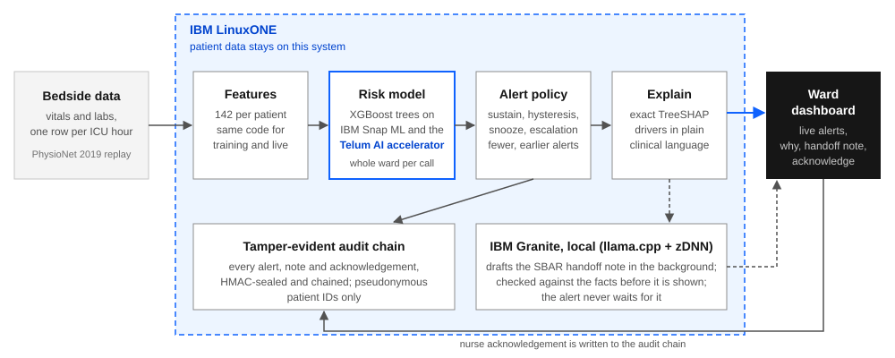
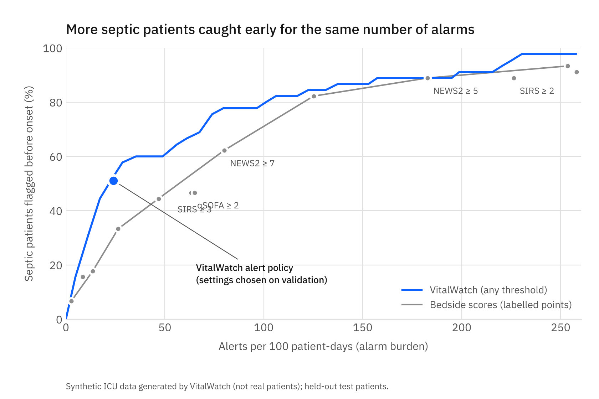
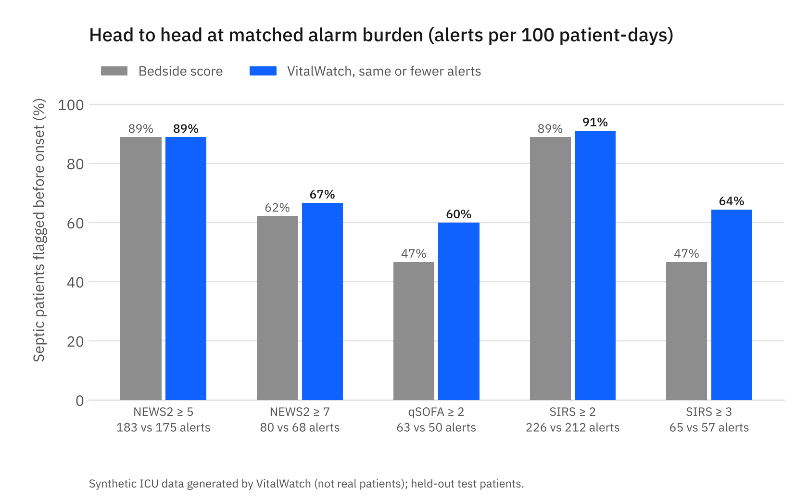
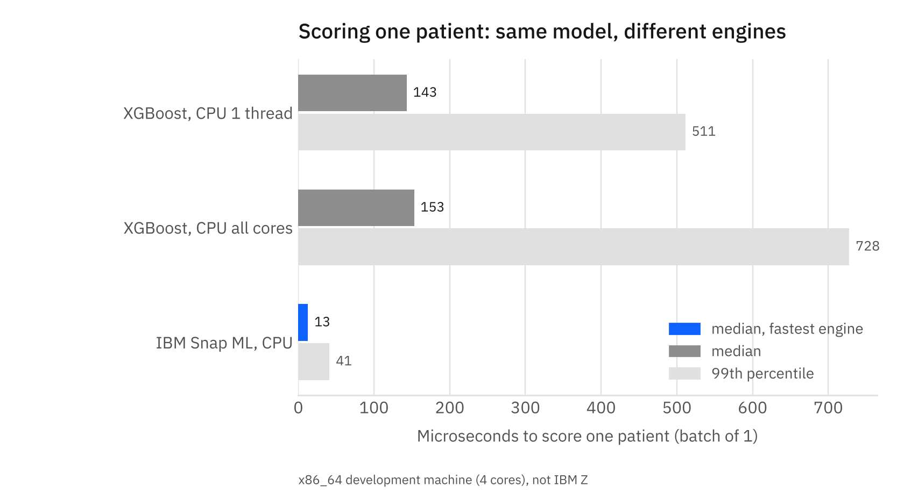
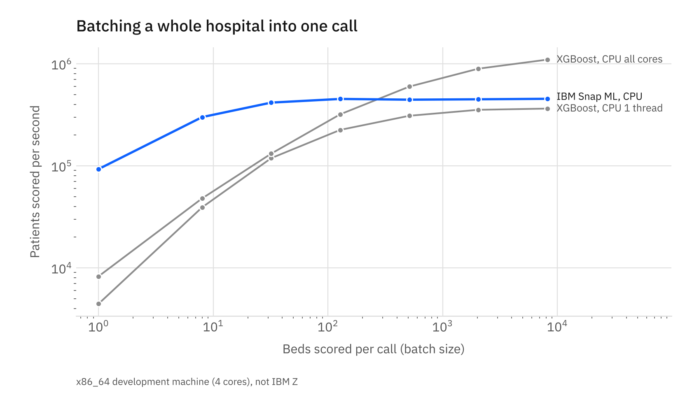
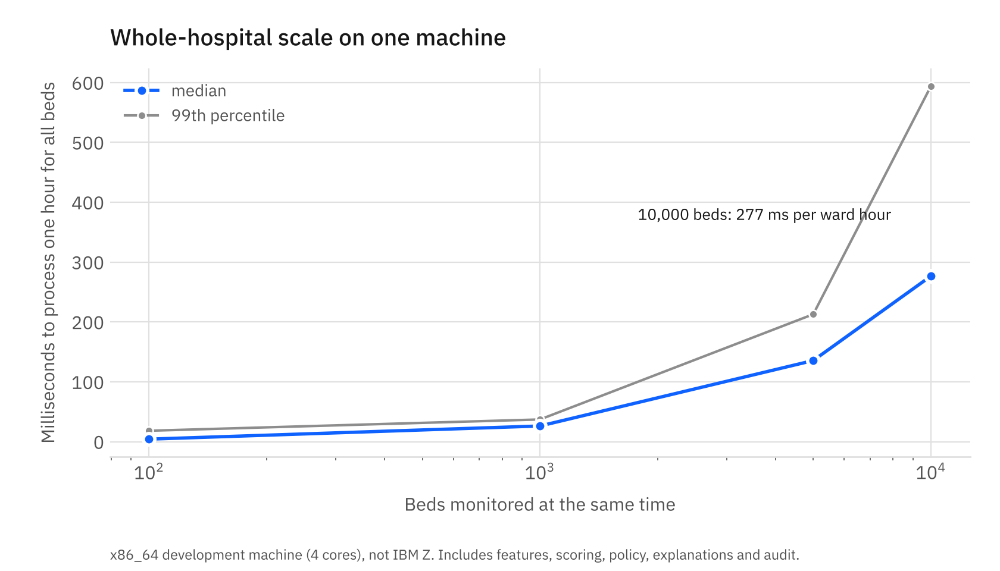

<p align="center">
  
</p>

<h3 align="center">Real-time AI for critical care decisions on IBM LinuxONE</h3>

<p align="center">
IBM Z Datathon 2026 &middot; Event code <b>SSF2026</b> &middot; Track: <b>Real-Time AI for Critical Decisions</b> &middot; Theme: AI for Good
</p>

<p align="center">
<a href="docs/submission/VitalWatch_demo.mp4"><b>Demo video (2 min 58 s)</b></a> &middot; <a href="docs/submission/VitalWatch_deck.pdf"><b>Pitch deck (PDF)</b></a> &middot; <a href="docs/SUBMISSION.md">Submission text</a>
</p>

> **Project status at a glance**
>
> | Part | Status |
> |---|---|
> | Live dashboard, model, alert policy, explanations, audit log | Built and tested (91 automated tests pass) |
> | Results in this page | From our **synthetic** ICU dataset, which is built in the same format as the real PhysioNet 2019 data. The real-data run is one script on LinuxONE (see [Deploy on IBM LinuxONE](#12-deploy-on-ibm-linuxone)). |
> | Benchmarks in this page | Measured on an **x86 development machine** as a reference. The IBM Telum accelerator numbers are produced by the same command on LinuxONE. |
> | IBM Granite handoff notes | Built. They need the Granite model that ships in IBM's LinuxONE container; without it, instant template notes are used. |



## Contents

1. [Overview](#1-overview)
2. [The problem](#2-the-problem)
3. [What VitalWatch does](#3-what-vitalwatch-does)
4. [Try it in 2 minutes](#4-try-it-in-2-minutes)
5. [How it works](#5-how-it-works)
6. [Results](#6-results)
7. [Benchmarks](#7-benchmarks)
8. [Why IBM Z](#8-why-ibm-z)
9. [Privacy and safety](#9-privacy-and-safety)
10. [Responsible AI](#10-responsible-ai)
11. [Judging criteria](#11-judging-criteria)
12. [Deploy on IBM LinuxONE](#12-deploy-on-ibm-linuxone)
13. [Command reference](#13-command-reference)
14. [Configuration](#14-configuration)
15. [Testing](#15-testing)
16. [Project structure](#16-project-structure)
17. [Hackathon rules](#17-hackathon-rules)
18. [FAQ and troubleshooting](#18-faq-and-troubleshooting)
19. [Credits, licence and references](#19-credits-licence-and-references)

## 1. Overview

**In one sentence:** VitalWatch watches every ICU patient's vital signs and lab results, hour by hour, and warns the nurse early when a patient may be developing sepsis.

- **Earlier:** it looks for the rising pattern hours before the clinical onset.
- **Fewer alarms:** it only alerts when the risk keeps rising or jumps sharply, and stays quiet after a nurse has responded.
- **Explained:** every alert says why ("heart rate 125, up 27 in the last 6 hours") and comes with a ready-written handoff note.
- **Private and auditable:** everything runs on one IBM LinuxONE system. Patient names and IDs are never shown, and every decision is recorded in a log that reveals any tampering.

<table>
<tr>
<td align="center" width="25%"><picture><source media="(prefers-color-scheme: dark)" srcset="docs/assets/logos/ibm--z17-dark.svg"></picture><br><b>Real time on IBM Z</b><br><sub>every bed scored in one call, in milliseconds</sub></td>
<td align="center" width="25%"><picture><source media="(prefers-color-scheme: dark)" srcset="docs/assets/logos/ai--explainability-dark.svg"></picture><br><b>Explained</b><br><sub>why each alert fired, in clinical words</sub></td>
<td align="center" width="25%"><picture><source media="(prefers-color-scheme: dark)" srcset="docs/assets/logos/ai--privacy-dark.svg"></picture><br><b>Private by design</b><br><sub>local IBM Granite; data stays on the system</sub></td>
<td align="center" width="25%"><picture><source media="(prefers-color-scheme: dark)" srcset="docs/assets/logos/audit-trail-dark.svg"></picture><br><b>Audited</b><br><sub>tamper-evident record of every decision</sub></td>
</tr>
</table>

## 2. The problem

**In one sentence:** sepsis kills quickly, and ICU staff are already overwhelmed by false alarms.

- **Sepsis** is the body's extreme reaction to an infection. It caused about **11 million deaths** worldwide in one year (Rudd et al., *Lancet* 2020).
- **Every hour counts.** Each hour of delay in sepsis treatment raises the odds of dying in hospital by about **4%** (Seymour et al., *NEJM* 2017).
- **Alarm fatigue.** Between **72% and 99%** of clinical alarms are false (Sendelbach and Funk, *AACN Advanced Critical Care* 2013), so staff learn to ignore them.

A useful warning system must therefore be **earlier**, raise **fewer** alarms, and **explain** itself.

## 3. What VitalWatch does

**In one sentence:** every hour, for every bed, VitalWatch scores the risk, decides whether to alert, explains why, and records what happened.

| Step | What happens | Why it matters |
|---|---|---|
| 1. Read | The newest hour of vitals (heart rate, blood pressure, breathing rate, oxygen, temperature) and lab results arrives for each bed. | Same data an ICU already records. |
| 2. Summarise | 142 "features" are computed per patient, such as the latest values, 6-hour trends and how long since each lab was taken. | Trends reveal deterioration earlier than single values. |
| 3. Score | One call scores the whole ward. On IBM Z this runs on the **Telum on-chip AI accelerator** through IBM Snap ML. | Milliseconds, even for thousands of beds. |
| 4. Decide | An alert policy fires only on sustained or sharply rising risk. After a nurse acknowledges, the bed is snoozed unless it keeps getting worse. Unanswered alerts escalate. | Fewer, more meaningful alarms. |
| 5. Explain | The top reasons are shown in plain words. A handoff note in the standard **SBAR** format (Situation, Background, Assessment, Recommendation) appears instantly, and **IBM Granite**, running locally, drafts a richer one. | The nurse knows why and what to say to the doctor. |
| 6. Record | Every alert, note and acknowledgement goes into a sealed, chained audit log. | Anyone can later prove nothing was changed. |

| Live ward | Handoff note and acknowledgement |
|---|---|
|  |  |

## 4. Try it in 2 minutes

**In one sentence:** one command builds everything it needs and opens the live ward.

You need Python 3.12 (3.11 also works).

```bash
git clone https://github.com/Ritesh-Root/BM-Z-Datathon-2026.git
cd BM-Z-Datathon-2026
python3.12 -m venv .venv && . .venv/bin/activate
pip install -r requirements-dev.txt
python -m vitalwatch demo --open
```

Then open **http://localhost:38080** in a browser.

The first run takes about 30 seconds. It creates the synthetic patients, trains the model and chooses the alert settings. After that:

- **The ward grid** shows 24 beds. Each tile has the risk, a 48-hour risk line with the alert threshold, and the latest vitals.
- **Within a few simulated hours** a bed turns red and appears in the alert strip at the top.
- **Click the bed** to see why it alerted, the handoff note, and the **Acknowledge** button.
- **The footer** shows the scoring time, the alert count against what a plain threshold would have raised, and **Verify chain**, which checks the audit log.
- **Speed buttons** (1x, 4x, 10x) fast-forward the replay. **Labelled onset** shows when the dataset says sepsis began (for evaluation only; the model never sees it).

`--open` skips the ward token for local use. Without it, the server prints a link that includes a token, and only browsers with the token can acknowledge alerts.

## 5. How it works

**In one sentence:** a single loop processes one ICU hour for the whole ward, and the language model works on the side so it never slows an alert.



| Component | What it does | Code |
|---|---|---|
| Data | Reads PhysioNet-format files; makes the synthetic cohort; splits patients | `vitalwatch/data/` |
| Features | 142 features per patient-hour; the same code is used for training and live use | `vitalwatch/features/` |
| Clinical scores | NEWS2, qSOFA, SIRS and partial SOFA, from their published definitions | `vitalwatch/clinical/scores.py` |
| Model | XGBoost training, calibration, portable model files, XGBoost and Snap ML scorers | `vitalwatch/model/` |
| Alert policy | The state machine that decides when to alert | `vitalwatch/alerts/policy.py` |
| Evaluation | Metrics, comparison with bedside scores, fairness table, charts | `vitalwatch/evaluation/` |
| Explanations and notes | Reasons for each alert; SBAR notes; Granite integration and safety checks | `vitalwatch/explain/` |
| Privacy | Pseudonymous IDs and the audit chain | `vitalwatch/privacy/` |
| Live engine | Replay of patients, the hourly loop, event streaming, load test | `vitalwatch/stream/` |
| Dashboard | Flask web server and the browser page | `vitalwatch/web/` |

More detail: [docs/ARCHITECTURE.md](docs/ARCHITECTURE.md).

## 6. Results

**In one sentence:** at the same or lower number of alarms, VitalWatch flags more septic patients before onset than the standard bedside scores.

**How the test is kept fair**
- Patients are split into three groups: 70% train, 15% validation, 15% test. No patient appears in two groups.
- Every setting (threshold, alert policy) is chosen on the **validation** patients. The **test** patients are used once, only for the numbers below.
- The bedside scores (NEWS2, qSOFA, SIRS) go through the **same** snooze logic. They are compared at the **same alarm count**, because catching everyone is easy if you alarm all the time.

**What the numbers mean**

| Term | Plain meaning |
|---|---|
| Flagged before onset | Share of septic patients who got an alert in the 12 hours before sepsis began (or at onset) |
| Median warning | Typical number of hours between the first alert and sepsis onset |
| Alerts per 100 patient-days | Alarm load: 30 means about one alert per bed every 3 days |
| PPV | Share of alerts that were followed by sepsis in the next hours |
| AUROC / AUPRC | Standard scores for how well the risk ranks sick patients above others (1.0 is perfect) |
| Onset | First hour the dataset labels sepsis, plus 6 hours (the dataset switches its label on 6 hours early) |

<!-- results:start -->
**Data: SYNTHETIC.** These numbers come from VitalWatch's own simulated ICU cohort (PhysioNet file layout), used while the real dataset downloads. Run `scripts/pipeline_physionet.sh` on LinuxONE and `python -m vitalwatch report` to replace them with PhysioNet 2019 results.

| Headline (held-out test patients) | Value |
|---|---|
| Septic patients flagged before onset | **51%** (95% CI 38% to 64%) |
| Median warning before onset | **3 hours** |
| Alerts per 100 patient-days | **24.1** |
| Alerts that were followed by sepsis (PPV) | 17% |
| Hourly AUROC / AUPRC | 0.812 / 0.115 |

Head to head with bedside scores at the same or lower alarm burden (every VitalWatch setting chosen on validation patients, then reported once on test):

| Bedside score | Its alerts per 100 pt-days | It flags early | VitalWatch alerts | VitalWatch flags early |
|---|---|---|---|---|
| NEWS2 ≥ 5 | 183 | 89% | 175 | **89%** |
| NEWS2 ≥ 7 | 80 | 62% | 68 | **67%** |
| qSOFA ≥ 2 | 63 | 47% | 50 | **60%** |
| SIRS ≥ 2 | 226 | 89% | 212 | **91%** |
| SIRS ≥ 3 | 65 | 47% | 57 | **64%** |

Fairness check (selected policy, test patients):

| Group | Patients | Septic | Flagged early | Alerts per 100 pt-days |
|---|---|---|---|---|
| sex: female | 267 | 22 | 50% | 22.9 |
| sex: male | 333 | 23 | 52% | 24.9 |
| age: 18-49 | 119 | 10 | 50% | 15.4 |
| age: 50-69 | 265 | 19 | 63% | 25.9 |
| age: 70+ | 216 | 16 | 38% | 26.5 |
| hospital: A | 297 | 21 | 48% | 21.7 |
| hospital: B | 303 | 24 | 54% | 26.3 |





<!-- results:end -->

Full method and limits: [docs/MODEL_CARD.md](docs/MODEL_CARD.md).

## 7. Benchmarks

**In one sentence:** the same model scores one patient in microseconds, and one machine handles 10,000 beds every hour.

**What is measured**
- **Inference engines.** The identical trained model is run by each available engine, each in its own process:
  - XGBoost on one CPU core;
  - XGBoost on all cores;
  - IBM Snap ML on the CPU;
  - IBM Snap ML on the **Telum on-chip AI accelerator**, available only on IBM z16 or z17.
- **For each engine:**
  - how long it takes to score one patient (median and the slowest 1% of calls);
  - how many patients per second it scores in large batches;
  - whether its alert decisions are identical to XGBoost's.
- **Whole-hospital load test.** The complete live engine (features, scoring, alert policy, explanations, audit log) for 100 to 10,000 beds at once.

<!-- bench:start -->
**Inference engines.** Measured on: x86_64 development machine with 4 CPU cores (a reference point, not IBM Z). Model: 191 trees, 142 features. Source file: `results/bench_x86_64_vm.json`.

| Engine | Score 1 patient (median) | Score 1 patient (slowest 1%) | Patients per second (batch of 8,192) | Same alert decisions as XGBoost |
|---|---|---|---|---|
| XGBoost 3.4.1 (CPU, 1 thread) | 143 microseconds | 511 microseconds | 339,002 | 100% |
| XGBoost 3.4.1 (CPU, 4 thread) | 153 microseconds | 728 microseconds | 891,216 | 100% |
| IBM Snap ML (compress_trees) | 13 microseconds | 41 microseconds | 356,668 | 100% |
| IBM Snap ML on the Telum AI accelerator | not available on this machine (needs IBM Z (z16/z17) with the zDNN library) | | | |





**Whole-hospital load test.** Measured on: x86_64 development machine with 4 CPU cores (a reference point, not IBM Z). Each row runs the full live engine for 12 simulated hours: features, scoring, alert policy, explanations and audit log for every bed. Source file: `results/loadtest_x86_64.json`.

| Beds at once | Time for one ward-hour (median) | Slowest 1% | Of which: scoring | Alerts in 12 h |
|---|---|---|---|---|
| 100 | 4 ms | 18 ms | 1 ms | 8 |
| 1,000 | 26 ms | 37 ms | 4 ms | 49 |
| 5,000 | 136 ms | 213 ms | 19 ms | 268 |
| 10,000 | 277 ms | 594 ms | 35 ms | 554 |



<!-- bench:end -->

**How to read these numbers**
- **1 ms = 1,000 microseconds.** A new hourly reading reaches the screen as an alert in about 5 to 7 ms end to end (dashboard footer, "Alert path p99").
- **Snap ML on the CPU** is about 10 times faster than XGBoost for one patient, with identical decisions.
- **More threads help big batches, not single patients.** XGBoost on all cores is faster for large batches but slightly slower for a single patient, because starting threads costs more than the work.
- **Scoring is a small part of the work.** At 10,000 beds, most of the time is feature computation; scoring the whole hospital in one batched call is only about 35 ms.
- **Unavailable engines are reported, never estimated.** The Telum row stays empty until the benchmark runs on IBM Z.

**Reproduce**

```bash
python -m vitalwatch bench        # inference engines -> results/bench_<arch>_<host>.json
python -m vitalwatch loadtest     # 100 to 10,000 beds -> results/loadtest_<arch>.json
python -m vitalwatch charts       # redraw the charts
python -m vitalwatch report       # rewrite the Results and Benchmarks sections of this README
```

On LinuxONE the same commands add the Telum accelerator row automatically, and `report` puts the IBM Z numbers first.

## 8. Why IBM Z

**In one sentence:** the decision has to happen next to the clinical data, in milliseconds, without sending patient data anywhere; that is what IBM Z is built for.

| What VitalWatch needs | How IBM Z / LinuxONE provides it | Status |
|---|---|---|
| Score every patient within milliseconds, next to the data | The Telum on-chip AI accelerator, used by IBM Snap ML on our exact XGBoost model | Built; measured by `bench` on LinuxONE |
| Generative AI without a cloud API | IBM Granite on llama.cpp with IBM zDNN, on the same system | Built (model ships in IBM's container) |
| Same answers on every platform | Portable text model files; 256 reference predictions re-checked on big-endian IBM Z | Built (`verify-artifacts`) |
| Whole-hospital scale on one system | Batched scoring of every bed per call; vertical scale | Load test from 100 to 10,000 beds |
| Trustworthy records | Tamper-evident audit chain; pervasive encryption and Crypto Express for keys | Chain built; encryption and hardware keys are the production plan |
| Confidential computing | IBM Secure Execution for Linux | Production plan |

**Terms used here**
- **"Big-endian"** means IBM Z stores numbers in the opposite byte order to a laptop. VitalWatch checks that its model gives identical answers on both.
- **"Telum"** is the processor in IBM z16 and z17, which has an AI accelerator built into the chip.

## 9. Privacy and safety

**In one sentence:** patient identity never leaves the replay source, the language model runs locally, and every decision can be verified later.

- **Pseudonyms only.** The dashboard, the audit log and the language model see an ID such as `VW-3FA9C10B2E` and an age band such as `60-69`, never the real record ID or exact age. A test fails if a real ID ever leaks.
- **Local language model.** IBM Granite runs on the same machine and receives only a short list of facts.
- **Safe notes.** A generated note is shown only if all of these hold; otherwise the template note stays:
  - it follows the SBAR format;
  - it is short;
  - it uses only numbers that are in the facts;
  - it contains no diagnosis and no drug or dose advice.
- **Tamper-evident audit log.** Each record is sealed with a secret key (HMAC-SHA256) and linked to the one before it.
  - `python -m vitalwatch audit verify` checks the whole chain.
  - `audit tamper-copy --seq 2` makes an edited copy, to show that verification names the changed record.
- **Ward token.** Acknowledge and control buttons require a token.

More: [docs/PRIVACY.md](docs/PRIVACY.md).

## 10. Responsible AI

**In one sentence:** we measure fairness, explain every alert, and state the limits plainly.

- **Fairness check:** results by sex, age band and hospital are in the Results section above. On the synthetic data, patients aged 70 and over were flagged early less often. This gap is named in the model card and must be re-checked on real data.
- **Explanations:** only clinical signals are shown as reasons. Context such as hours in ICU is used by the model but never shown, because a nurse cannot act on it.
- **Limits:**
  - This is decision support, not a diagnosis or a medical device.
  - The evaluation is retrospective, on one public dataset from two hospital systems.
  - The sepsis label is a retrospective proxy.

Full model card: [docs/MODEL_CARD.md](docs/MODEL_CARD.md).

## 11. Judging criteria

| Criterion | Evidence in VitalWatch |
|---|---|
| Innovation and creativity | Alert policy designed against alarm fatigue; local LLM notes checked against facts; tamper-evident decision log |
| Technical implementation and complexity | One feature definition for training and live use, verified by a parity test; streaming engine; state-machine policy; exact explanations; asynchronous LLM; 91 automated tests |
| Relevance and impact (AI for Good) | Earlier sepsis recognition with fewer alarms, compared with NEWS2, qSOFA and SIRS at the same alarm count |
| Why IBM Z | Telum accelerator through Snap ML; Granite on the same system; big-endian verified model; whole-hospital load test |
| Scalability and feasibility | 100 to 10,000 simultaneous beds on one machine; runs in IBM's stock LinuxONE container plus two packages |
| Presentation clarity | This page, a captioned [demo video](docs/submission/VitalWatch_demo.mp4) under 3 minutes, a [pitch deck](docs/submission/VitalWatch_deck.pdf) and a voice-over [script](docs/DEMO_SCRIPT.md) |
| Responsible AI | Fairness table, model card, privacy notes, stated limits |

## 12. Deploy on IBM LinuxONE

**In one sentence:** four scripts take a fresh LinuxONE Community Cloud server to real-data results and a live dashboard.

1. Create a LinuxONE Community Cloud server (event code **SSF2026**, image **Ubuntu 24.04-Datathon**) and start IBM's JupyterLab container, as in IBM's [jupyter-lab-ml guide](https://github.com/linuxone-community-cloud/jupyter-lab-ml).
2. On the server:

```bash
cd ~/shared && git clone https://github.com/Ritesh-Root/BM-Z-Datathon-2026.git && cd BM-Z-Datathon-2026
scripts/vm_setup.sh              # installs Flask + Snap ML, finds zDNN and Granite, opens port 38080, runs doctor
scripts/pipeline_physionet.sh    # downloads PhysioNet 2019, trains, evaluates, benchmarks, load-tests (30-60 min)
scripts/run_vm.sh physionet      # starts the dashboard; prints the link
python -m vitalwatch report      # inside the container: refresh this README with the IBM Z numbers
```

3. Commit and push `artifacts/`, `results/` and `README.md`.

Step-by-step guide with checks and troubleshooting: [docs/DEPLOY_LINUXONE.md](docs/DEPLOY_LINUXONE.md).

## 13. Command reference

All commands are `python -m vitalwatch <command>`.

| Command | What it does |
|---|---|
| `doctor` | Shows the platform, byte order, whether the Telum accelerator is usable, and whether Snap ML and Granite are found |
| `synth` | Creates the synthetic ICU cohort (PhysioNet file layout) |
| `ingest --source synthetic\|physionet` | Reads the patient files into a fast cache |
| `split` | Splits patients into train, validation and test |
| `train` | Trains the model and writes `artifacts/` |
| `evaluate` | Chooses the alert policy on validation; reports test results against the bedside scores |
| `charts` | Draws all result and benchmark charts |
| `report` | Rewrites the Results and Benchmarks sections of this README |
| `verify-artifacts` | Checks the 256 reference predictions on this machine |
| `bench` | Inference benchmark on every available engine |
| `loadtest` | Whole-hospital load test |
| `serve` | Starts the dashboard |
| `demo` | Builds anything missing, then starts the dashboard |
| `audit verify` | Checks an audit log |
| `audit tamper-copy --seq N` | Makes an edited copy of a log to show tamper detection |

Useful options for `serve` and `demo`:
- `--port`
- `--speed` (replay speed)
- `--no-llm` (template notes only)
- `--open` (no ward token, local use only)
- `--source physionet`

## 14. Configuration

Settings live in `configs/default.toml`. Any value can be overridden with an environment variable `VW_<SECTION>_<KEY>`, for example `VW_SERVER_PORT=38081`.

| Section | Key settings |
|---|---|
| `data` | `source` (synthetic or physionet), `seed` |
| `synth` | `n_patients` (4,000), `sepsis_rate` (8%) |
| `engine` | `n_beds` (24), `tick_seconds` (5 seconds per simulated hour), `speed` |
| `scorer` | `kind`: `auto` uses Snap ML on the Telum accelerator when available, otherwise XGBoost |
| `llm` | `backend` (`auto`, `granite` or `off`), `model_path`, `max_tokens`, `timeout_s` |
| `server` | `host`, `port` (38080), `token` |

Other environment variables:
- `VW_GRANITE_GGUF`: path to the Granite model file.
- `SNAPML_ZDNN_LIB`: path to the zDNN library.
- `VW_AUDIT_KEY` and `VW_PSEUDO_KEY`: secret keys as hex. Otherwise keys are created in `secrets/`, which git ignores.

## 15. Testing

**In one sentence:** 91 automated tests cover the data, the maths, safety and the live system.

```bash
pytest
```

| Test file | Tests | What it checks |
|---|---|---|
| `test_data.py` | 8 | File layout, repeatable synthetic data, labels, byte-order-safe cache, patient splits |
| `test_features.py` | 47 | Live features equal training features exactly (with beds changing patients); no peeking at future hours; NEWS2/qSOFA/SIRS score tables |
| `test_model.py` | 6 | Saved model matches reference predictions; Snap ML equals XGBoost; feature-version mismatch is refused |
| `test_policy.py` | 11 | Alert logic: sustain, hysteresis, rise, snooze, breakthrough, escalation, resolve; fast and reference versions agree |
| `test_metrics.py` | 2 | Metrics on a hand-calculated example |
| `test_live.py` | 13 | Pseudonyms, audit tamper detection, note safety checks, notes never slow the alert path, no real IDs leak, web API, token, live event stream |
| `test_platform.py` | 2 | Accelerator detection; benchmark reports unavailable engines honestly |
| `test_repo_hygiene.py` | 2 | No emoji anywhere; every logo and font is licensed and credited |

**Also checked by hand for this release:**
- a fresh clone started with `demo` and alerted within 30 seconds;
- in a real browser, the dashboard loaded with no errors, an alert opened, acknowledge worked, and the chain verified;
- a tampered audit copy was caught at the edited record;
- the reference predictions passed for XGBoost and Snap ML.

## 16. Project structure

```
vitalwatch/     the application (see the table in section 5)
scripts/        LinuxONE setup, real-data pipeline, dashboard launcher, data download
tests/          the 91 automated tests
configs/        default settings
artifacts/      trained model (JSON), metadata, alert policy, reference predictions
results/        metrics, benchmark and load-test results (JSON) and charts
scenarios/      the curated demo ward
docs/           model card, privacy, architecture, deployment, demo script, submission text, credits, images
docs/submission/ demo video (MP4) and pitch deck (PDF), ready to upload
```

## 17. Hackathon rules

- **Event code:** SSF2026.
- **Built from scratch during the datathon.** VitalWatch was started and built during the IBM Z Datathon 2026 hacking period; the commit history shows the progress. No earlier project and nobody else's code was reused.
- **Original work.** Clinical scores and metrics are implemented by us from their published definitions.
- **Open-source libraries and data are credited** with links and licences in [docs/OSS_CREDITS.md](docs/OSS_CREDITS.md). IBM-provided tools (LinuxONE Community Cloud, Snap ML, zDNN, Granite) are used as the datathon allows.
- **No emoji** are used anywhere; logos and icons come from IBM's Carbon Design System and simple-icons.
- **Topic:** healthcare and patient safety. No political content.

## 18. FAQ and troubleshooting

**Are these real patients?**
Not yet. The page shows results on synthetic patients that follow the real PhysioNet 2019 format. On LinuxONE, `scripts/pipeline_physionet.sh` downloads the real, open-access data, and `report` updates this page.

**Port 38080 is already in use.**
Run `python -m vitalwatch demo --open --port 38081`.

**The Telum accelerator shows as not available.**
That is expected on any machine that is not an IBM z16 or z17, or when the virtual server does not expose it. VitalWatch then scores on the CPU and says so in the dashboard header and the benchmark table.

**Granite is not found.**
The template note is used and everything else works. On LinuxONE, `scripts/vm_setup.sh` finds the bundled model. Only the big-endian model that ships in IBM's container works on IBM Z.

**PhysioNet download fails.**
Re-run `scripts/download_physionet.sh`, or download on a laptop and copy it to the server with `scp`.

**How do I prove the audit log was not changed?**
Click **Verify chain** in the dashboard footer, or run `python -m vitalwatch audit verify`.

## 19. Credits, licence and references

**Built with**

<p>
<picture><source media="(prefers-color-scheme: dark)" srcset="docs/assets/logos/linuxone-5-dark.svg"></picture>&nbsp;
<picture><source media="(prefers-color-scheme: dark)" srcset="docs/assets/logos/ibm--granite-dark.svg"></picture>&nbsp;
<picture><source media="(prefers-color-scheme: dark)" srcset="docs/assets/logos/python-dark.svg"></picture>&nbsp;
<picture><source media="(prefers-color-scheme: dark)" srcset="docs/assets/logos/numpy-dark.svg"></picture>&nbsp;
<picture><source media="(prefers-color-scheme: dark)" srcset="docs/assets/logos/pandas-dark.svg"></picture>&nbsp;
<picture><source media="(prefers-color-scheme: dark)" srcset="docs/assets/logos/scikitlearn-dark.svg"></picture>&nbsp;
<picture><source media="(prefers-color-scheme: dark)" srcset="docs/assets/logos/flask-dark.svg"></picture>&nbsp;
<picture><source media="(prefers-color-scheme: dark)" srcset="docs/assets/logos/docker-dark.svg"></picture>&nbsp;
<picture><source media="(prefers-color-scheme: dark)" srcset="docs/assets/logos/ubuntu-dark.svg"></picture>&nbsp;
<picture><source media="(prefers-color-scheme: dark)" srcset="docs/assets/logos/jupyter-dark.svg"></picture>&nbsp;
<picture><source media="(prefers-color-scheme: dark)" srcset="docs/assets/logos/pytest-dark.svg"></picture>&nbsp;

</p>

<sub>XGBoost, IBM Snap ML, IBM zDNN and the PhysioNet 2019 dataset are credited in docs/OSS_CREDITS.md with all other libraries, fonts and icon sets. Product names and logos belong to their owners and only identify the technology used. The IBM 8-bar logo is not used. Icons and pictograms come from the IBM Carbon Design System (Apache-2.0) and simple-icons (CC0).</sub>

**Licence:** Apache-2.0 for our code.

**Disclaimer:** VitalWatch is a research prototype for decision support. It is not a medical device and does not diagnose.

**Other documents**
- [Model card](docs/MODEL_CARD.md)
- [Privacy](docs/PRIVACY.md)
- [Architecture](docs/ARCHITECTURE.md)
- [Deploy on LinuxONE](docs/DEPLOY_LINUXONE.md)
- [Demo video](docs/submission/VitalWatch_demo.mp4) and [script](docs/DEMO_SCRIPT.md)
- [Pitch deck (PDF)](docs/submission/VitalWatch_deck.pdf)
- [Submission text](docs/SUBMISSION.md)
- [Credits](docs/OSS_CREDITS.md)

**References**
1. Rudd KE, et al. Global, regional, and national sepsis incidence and mortality, 1990-2017. *Lancet* 2020;395:200-211.
2. Seymour CW, et al. Time to treatment and mortality during mandated emergency care for sepsis. *N Engl J Med* 2017;376:2235-2244.
3. Sendelbach S, Funk M. Alarm fatigue: a patient safety concern. *AACN Adv Crit Care* 2013;24(4):378-386.
4. Reyna MA, et al. Early prediction of sepsis from clinical data: the PhysioNet/Computing in Cardiology Challenge 2019. *Crit Care Med* 2020;48(2):210-217.
5. Royal College of Physicians. National Early Warning Score (NEWS) 2. 2017.
6. Singer M, et al. The Third International Consensus Definitions for Sepsis and Septic Shock (Sepsis-3). *JAMA* 2016;315(8):801-810.
